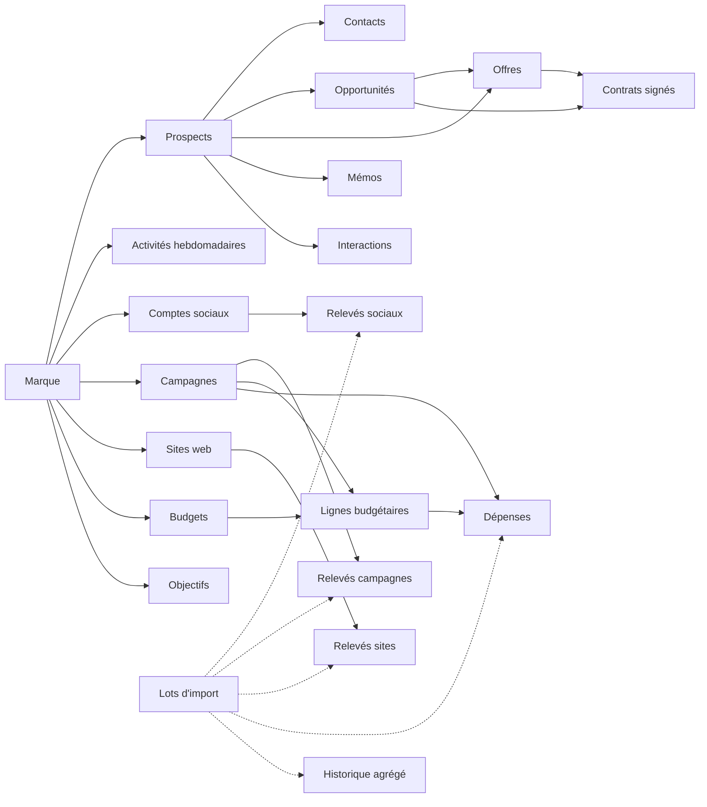

# MAXreport — Architecture fonctionnelle et technique

> Proposition à valider · 2 novembre 2026 · Basée sur le dépôt `remaxci/MAXReport` (commit `fc04b60`)

1. [Audit de l'existant](#1-audit-de-lexistant)
2. [Architecture fonctionnelle recommandée](#2-architecture-fonctionnelle-recommandée)
3. [Modules et relations](#3-modules-et-relations)
4. [Schéma de données Supabase](#4-schéma-de-données-supabase)
5. [Personnalisation sans code](#5-personnalisation-sans-code)
6. [Règles de calcul et de consolidation](#6-règles-de-calcul-et-de-consolidation)
7. [Plan de développement par sprints](#7-plan-de-développement-par-sprints)
8. [Décisions à valider](#8-décisions-à-valider)

---

## 1. Audit de l'existant

### Ce qui existe

| Élément | État | Décision |
|---|---|---|
| Next.js 16.4 (App Router), React 19.3, TypeScript, Tailwind 4 | En place, build OK | Conserver |
| Cache Components + Partial Prefetching | Activés | Conserver : toute lecture de session derrière `<Suspense>` |
| `src/proxy.ts` (ex-middleware) | Rafraîchit la session, redirige vers `/login` | Conserver ; ajouter la redirection vers la marque par défaut |
| Clients Supabase serveur et navigateur (`@supabase/ssr` 0.12) | En place | Conserver ; les typer avec les types générés |
| `getCurrentUser()` (`src/lib/auth.ts`) | Lit les claims JWT | Faire évoluer en couche d'autorisation (profil, marques, permissions) |
| Connexion e-mail / mot de passe, déconnexion | En place | Conserver ; ajouter invitation et mot de passe oublié |
| Tableau de bord | Vide | Remplacer par les tableaux de bord marque et Direction |
| Base Supabase `MAXreport` (Postgres 17, eu-west-1) | Vide, aucune table | Créer le schéma par migrations versionnées |
| Vercel `remaxci/max-report` | Relié à GitHub, variables en place | Conserver |

### Ce qui manque

- shadcn/ui (prévu dans la stack, pas encore installé), graphiques, formulaires (react-hook-form + Zod).
- Tests automatisés : aucun.
- Migrations SQL versionnées dans le dépôt, types TypeScript générés depuis la base.
- Tout le modèle de données, les rôles et la RLS.

### Risques à traiter avant d'aller plus loin

| Risque | Impact | Correction proposée |
|---|---|---|
| Tout push sur `main` déploie en production | Contraire à la règle « pas de production sans validation » | Travailler sur des branches (`sprint-1/...`) qui donnent une URL Preview Vercel ; fusionner dans `main` seulement après validation |
| Un seul projet Supabase pour le développement et la production | Chaque migration de test touche la base de production | Créer un projet `MAXreport-dev` ; Preview Vercel → dev, Production → prod |
| Vercel Hobby | Offre réservée à un usage personnel non commercial | Passer en Pro avant la mise en service réelle |
| Supabase Free | Projet mis en pause après 7 jours d'inactivité, pas de sauvegardes quotidiennes | Passer en Pro avant d'y mettre des données réelles |

---

## 2. Architecture fonctionnelle recommandée

### Principes directeurs

1. **La marque est la frontière de sécurité.** Chaque donnée métier porte un `brand_id` obligatoire, et la RLS Supabase isole les marques. L'isolation ne dépend jamais de l'interface.
2. **Deux verrous.** Le serveur Next.js vérifie les permissions avant chaque action ; la RLS les revérifie en base. Le navigateur n'est jamais cru sur parole.
3. **Une seule source de vérité par indicateur.** Chaque chiffre affiché vient d'une seule table, selon une règle écrite (section 6). C'est ce qui empêche les doubles comptages.
4. **La personnalisation est de la donnée, jamais du SQL.** Les administrateurs modifient des définitions stockées en base ; aucun écran ne modifie le schéma.
5. **Aucune donnée inventée.** Les chiffres viennent de la saisie ou de l'import. Les connecteurs (GA4, Search Console, régies publicitaires) sont prévus dans le modèle mais ne sont pas simulés.

### Couches

```
Navigateur (React, shadcn/ui)
   │  formulaires → Server Actions        lectures → Server Components
   ▼
Serveur Next.js (Vercel)
   ├─ src/server/authz     contexte utilisateur, marques autorisées, permissions
   ├─ src/features/*       requêtes, actions et schémas Zod de chaque module
   └─ src/lib/metrics      catalogue d'indicateurs et formules (testées)
   │  client Supabase avec le jeton de l'utilisateur → RLS appliquée
   ▼
Supabase
   ├─ Postgres : tables, RLS, fonctions d'agrégation, triggers d'audit
   ├─ Auth     : comptes, invitations
   └─ Storage  : bucket privé « attachments », URL signées de courte durée
```

L'application n'utilise aucune clé secrète Supabase : les invitations partent de Supabase (Authentication › Users › *Invite user*), et l'application ne fait que recevoir le lien. Si une clé secrète devenait nécessaire, elle resterait côté serveur, sans le préfixe `NEXT_PUBLIC_`.

**Accès par e-mail** (évolution du 3 novembre 2026). Les e-mails d'invitation et de réinitialisation (modèles dans `supabase/templates/`) mènent à `/confirmer-acces?token_hash=…&type=invite|recovery`. La page affiche seulement le formulaire du mot de passe ; le jeton est vérifié à l'envoi (`verifyOtp`, puis `updateUser`), si bien qu'un antivirus de messagerie qui visite le lien ne le consomme pas. Le mot de passe est contrôlé avant la vérification (10 caractères au moins, 72 octets au plus), pour ne pas griller un lien sur un refus ; si Supabase le rejette malgré tout, la session est fermée et il faut un nouveau lien. `/mot-de-passe-oublie` répond de la même façon que le compte existe ou non. `/compte` permet de changer son mot de passe en confirmant l'actuel. La logique est dans `src/features/auth/flows.ts`, testée sans réseau. Tant que la variable serveur `EMAIL_LINKS_ENABLED` ne vaut pas `true` (à poser une fois le SMTP et les modèles en place, puis redéployer), « Mot de passe oublié ? » est masqué, la demande de lien est refusée et les aides à l'écran indiquent *Add user* avec un mot de passe provisoire.

### Navigation

```
/login · /mot-de-passe-oublie · /confirmer-acces   (sans session)
/compte                    mot de passe de la personne connectée
/                          → marque par défaut de l'utilisateur, ou /direction
/direction                 tableau de bord consolidé (filtres marque et période)
/m/[marque]                tableau de bord de la marque
/m/[marque]/marketing/     reseaux · campagnes · sites
/m/[marque]/commercial/    activites · prospects · opportunites · offres · memos · contrats
/m/[marque]/commerciaux    comparaison des commerciaux (chiffres, graphiques, export Excel)
/m/[marque]/objectifs
/m/[marque]/budgets
/m/[marque]/rapports
/m/[marque]/imports
/m/[marque]/parametres     modules, champs, listes, statuts, pipeline, indicateurs, modèles
/parametres                marques, collaborateurs, rôles, devises et taux
```

Le sélecteur de marque n'affiche que les marques autorisées. Un module désactivé pour une marque disparaît du menu et ses pages renvoient une erreur 404.

### Organisation du code

```
src/
  app/                  routes, aussi minces que possible
  features/<module>/    queries.ts · actions.ts · schemas.ts · components/
  server/authz/         getContext(), requirePermission(), brandsWith()
  lib/metrics/          catalogue d'indicateurs, formules, conversion de devises
  lib/supabase/         clients + database.types.ts (généré)
  components/ui/        composants shadcn/ui
supabase/
  migrations/           SQL versionné : source de vérité du schéma
  tests/                tests RLS
```

### Environnements et livraison

| Environnement | Code | Base Supabase | Accès |
|---|---|---|---|
| Local | branche de travail | MAXreport-dev | développeur |
| Preview Vercel | chaque branche poussée | MAXreport-dev | protégé par Vercel |
| Production | `main` uniquement | MAXreport | utilisateurs |

Les migrations sont écrites dans `supabase/migrations/`, appliquées sur dev, puis sur prod au moment de la fusion validée.

---

## 3. Modules et relations

| Module | Contenu | Dépend de |
|---|---|---|
| **Noyau** | marques, profils, rôles et permissions, affectations, journal d'audit, pièces jointes | — |
| **Paramètres** | modules par marque, champs personnalisés, listes, statuts, pipeline, indicateurs, modèles de rapports | Noyau |
| **Commercial** | prospects, contacts, opportunités, interactions, activités hebdomadaires, offres, mémos, contrats | Noyau, Paramètres |
| **Marketing** | plateformes, comptes sociaux, campagnes, sites web, relevés de performance | Noyau, Paramètres |
| **Budgets** | budgets, lignes budgétaires, dépenses, taux de change, alertes | Noyau, Marketing (campagnes) |
| **Objectifs** | objectifs individuels et collectifs sur un indicateur du catalogue | Commercial, Marketing, Budgets |
| **Imports et exports** | lots d'import, correspondance des colonnes, historique, exports Excel et PDF | tous |
| **Tableaux de bord** | vue marque, vue Direction | tous, en lecture seule |



---

## 4. Schéma de données Supabase

### Conventions

- Clé primaire `id uuid` (journaux : `bigint identity`).
- Toute table métier porte `brand_id uuid not null`, `created_at`, `created_by`, `updated_at`, `updated_by` et `archived_at`. On archive au lieu de supprimer.
- Les tables enfants référencent leur parent par **clé composite** `(brand_id, parent_id)`. Une offre de la marque A ne peut donc pas pointer vers un prospect de la marque B, même par erreur.
- Montants : `numeric(18,2)` + `currency char(3)` limitée à `XOF`, `USD`, `EUR`. Le montant d'origine n'est jamais converti en place.
- Champs personnalisés : colonne `custom jsonb not null default '{}'` sur chaque entité personnalisable.
- Lignes chiffrées : `source` (`manual`, `import`, `crm`, `api`) et `import_batch_id` le cas échéant.
- Fonctions internes dans un schéma `app`, non exposé par l'API.

### Noyau

| Table | Colonnes principales |
|---|---|
| `brands` | code (unique, figé, ex. `RMXCI`), name, slug, logo_path, primary_color, reporting_currency (`XOF`), timezone (`Africa/Abidjan`), is_active |
| `profiles` | id (= `auth.users.id`), full_name, email, phone, job_title, default_brand_id, is_active |
| `permissions` | key (ex. `offers.read_all`), module, label. Catalogue fixe, alimenté par migration |
| `roles` | key, label, description, is_system |
| `role_permissions` | role_id, permission |
| `memberships` | user_id, brand_id (**null = toutes les marques**), role_id ; unique (user_id, brand_id) |
| `audit_log` | brand_id, table_name, record_id, action, actor_id, at, changes jsonb (avant / après) |
| `attachments` | brand_id, entity, record_id, storage_path, file_name, mime_type, size_bytes |
| `reference_counters` | brand_id, kind (`offer`, `memo`), year, last_value |

**Rôles par défaut** (seul le super-administrateur les modifie) :

| Rôle | Portée | Droits principaux |
|---|---|---|
| Super-administrateur | toutes les marques | tout, y compris marques, rôles et permissions |
| Direction | toutes les marques | lecture de tout, tableaux consolidés, exports |
| Administrateur de marque | une marque | paramètres et collaborateurs de la marque |
| Responsable commercial | une marque | tout le commercial de la marque, validation des fiches hebdomadaires |
| Commercial | une marque | ses propres prospects, offres, mémos et activités |
| Marketing | une marque | réseaux, campagnes, sites, dépenses marketing |
| Lecture | une marque | consultation seule |

Un collaborateur peut avoir un rôle différent dans chaque marque.

**Modèle RLS.** Une fonction renvoie les marques sur lesquelles l'utilisateur détient une permission, et chaque politique s'en sert :

```sql
create function app.brands_with(p_permission text)
returns uuid[] language sql stable security definer set search_path = '' as $$
  select coalesce(array_agg(b.id), '{}')
  from public.brands b
  where exists (
    select 1
    from public.memberships m
    join public.role_permissions rp on rp.role_id = m.role_id
    join public.profiles p on p.id = m.user_id and p.is_active
    where m.user_id = (select auth.uid())
      and rp.permission = p_permission
      and (m.brand_id = b.id or m.brand_id is null)
  );
$$;

create policy offers_select on public.offers for select to authenticated using (
  brand_id = any ((select app.brands_with('offers.read_all')))
  or (owner_id = (select auth.uid())
      and brand_id = any ((select app.brands_with('offers.read_own'))))
);
```

Le `(select …)` fait évaluer la fonction une seule fois par requête, pas à chaque ligne. Le même principe s'applique à l'insertion et à la modification (`with check`). La suppression est réservée aux administrateurs ; la règle générale reste l'archivage.

**Journal d'audit.** Un trigger générique enregistre chaque création, modification et archivage sur les tables métier. Personne ne peut modifier ni supprimer le journal : il n'a aucune politique d'écriture.

**Pièces jointes.** Bucket Storage privé `attachments`, chemins `{brand_id}/{entité}/{id}/{uuid}-{nom}`. La politique Storage contrôle le `brand_id` du chemin avec `app.brands_with`. Téléchargement par URL signée valable 60 secondes.

### Paramètres

| Table | Rôle |
|---|---|
| `brand_modules` | brand_id, module, enabled, settings jsonb (dont la date de bascule vers le CRM) |
| `option_lists`, `option_items` | listes déroulantes par marque (sources, secteurs, objectifs de campagne, catégories de dépenses…) : value, label, color, position, is_active |
| `statuses` | brand_id, entity, key, label, color, position, is_default, **category** (`draft`, `active`, `success`, `failure`, `closed`) |
| `pipeline_stages` | brand_id, key, label, position, probability, category (`open`, `won`, `lost`) |
| `custom_field_definitions` | voir section 5 |
| `metric_settings` | brand_id, metric_key, enabled, source (`declared` ou `crm`), seuils d'alerte |
| `report_templates` | brand_id, name (unique par marque), description, sections (parmi commercial, objectives, social, campaigns, websites, budgets), period_kind |

### Commercial

| Table | Colonnes principales |
|---|---|
| `companies` | name, sector, city, country, phone, email, website, owner_id, source, status_id, next_follow_up_at, custom |
| `contacts` | company_id, full_name, job_title, email, phone, custom |
| `opportunities` | company_id, contact_id, owner_id, title, stage_id, amount, currency, expected_close_on, source, lost_reason, custom |
| `interactions` | company_id, opportunity_id, contact_id, user_id, type (appel, e-mail, rendez-vous, note), occurred_at, summary |
| `weekly_reports` | user_id, week_start (lundi), calls_prospecting, calls_follow_up, emails_sent, qualified_meetings, opportunities_declared\*, memos_declared\*, comments, status (`draft`, `submitted`, `validated`), submitted_at, validated_at, validated_by, custom ; unique (brand_id, user_id, week_start) |
| `commercial_documents` | **offres et mémos dans une même table** (colonne `kind` : `offer` ou `memo`), écrans distincts. reference (automatique et figée : offres `N°0001`, suite continue par marque depuis le 3 novembre 2026 ; mémos `MS-CODE-2026-0001`, suite annuelle), company_id, contact_id, owner_id, subject, issued_on (création ou rédaction), sent_on, status_id, follow_up_on, comments, custom ; offres seules : amount, currency, valid_until ; mémos seuls : recipient_response |
| `document_events` | chronologie : création, modification, changement de statut, envoi, relance prévue, relance faite, commentaire, pièce jointe, archivage. Alimentée par triggers ; seuls les commentaires et relances faites se saisissent |
| `document_attachments` | pièces jointes (bucket privé `attachments`, chemin `{brand_id}/{document_id}/…`, 4 Mo au plus) |
| `contracts` | company_id, opportunity_id, offer_id, owner_id, title, signed_on, amount, currency, start_on, end_on, custom |
| `objectives` | user_id (null = objectif collectif), metric_key, period_start, period_end, target_value, currency (obligatoire pour le chiffre d'affaires, interdite sinon), comments |

\* saisis à la main uniquement si le module correspondant (CRM, mémos) est désactivé pour la marque (section 6).

### Marketing

| Table | Colonnes principales |
|---|---|
| `platforms` | key (clé primaire), label, kind (`social`, `ads`, `offline`), position, is_active. Liste commune, alimentée par migration, en lecture seule pour les utilisateurs |
| `social_accounts` | platform (plateforme `social`), name, handle, url, archived_at |
| `social_snapshots` | account_id, period_start, period_end, followers_total, followers_new, reach, impressions, posts, interactions, clicks, source (`manual`, `import`), comments |
| `campaigns` | platform (plateforme `ads` ou `offline`), name, objective, status, start_on, end_on, planned_budget, currency, external_id, comments, custom, archived_at. La ligne budgétaire arrive au Sprint 7 |
| `campaign_snapshots` | campaign_id, period_start, period_end, spend, impressions, reach, clicks, leads, conversions, conversion_value, source, comments. Montants dans la devise de la campagne, qui se fige au premier relevé |
| `websites` | name, url, archived_at |
| `website_snapshots` | website_id, period_start, period_end, users, sessions, page_views, conversions, form_submissions, sessions par canal (`sessions_organic`, `_direct`, `_social`, `_paid`, `_referral`, `_email`, `_other`, dont la somme ne dépasse pas `sessions`), source, comments |

Chaque relevé porte au moins une mesure ; une mesure non saisie reste vide. Les objectifs de site (`website_goals`) rejoindront le catalogue d'indicateurs des objectifs au Sprint 8.

Une **contrainte d'exclusion** (`btree_gist`) interdit deux relevés dont les périodes se chevauchent pour un même compte, une même campagne ou un même site. Deux imports de la même semaine ne peuvent donc pas s'additionner.

### Budgets

| Table | Colonnes principales |
|---|---|
| `budgets` | name, scope (`marketing`, `commercial`, `other`), period_start, period_end, amount (enveloppe), currency, status (`draft`, `approved`, `closed`), comments, archived_at |
| `budget_lines` | budget_id, label, category (liste « Catégories de dépenses » de la marque), campaign_id (une ligne au plus par campagne et par budget), amount dans la devise du budget, position |
| `expenses` | budget_line_id (obligatoire), campaign_id (repris de la ligne), supplier, description, expense_date, amount, currency d'origine, status (`committed`, `paid`), paid_on, external_ref (une même facture d'un même fournisseur n'existe qu'une fois), source, import_batch_id, archived_at |
| `fx_rates` | rate_date, from_currency, to_currency, rate, source ; communs à toutes les marques, saisis par un rôle global (`fx_rates.manage`) ; la parité EUR/XOF n'y figure pas (fixe) |

Une campagne n'a pas de colonne de ligne budgétaire : c'est la ligne qui désigne sa campagne.

### Imports

| Table | Rôle |
|---|---|
| `import_batches` | brand_id, target (`social_snapshots`, `campaign_snapshots`, `website_snapshots`, `companies`, `historical_metrics`), file_name, file_size, file_sha256, headers et rows (lignes brutes du fichier, 5 000 au plus), mapping, options (formats de dates et de nombres, période déduite, objet par défaut, devise), status (`uploaded`, `committed`, `rolled_back`), compteurs, report (lignes écartées et motifs), auteurs et dates |
| `historical_metrics` | brand_id, user_id (null = équipe), metric_key, period_start, period_end, value, currency, comments, import_batch_id. Chiffres agrégés d'avant MAXreport, séparés des enregistrements saisis ; pas de recouvrement de périodes pour un même indicateur, collaborateur et devise |

Les lignes importées (relevés, prospects, historique) portent `import_batch_id`. Le fichier lui-même n'est pas stocké : ses lignes brutes et son empreinte suffisent à la traçabilité. Les modèles de correspondance ne sont pas une table à part : un nouveau fichier aux mêmes en-têtes reprend la correspondance du dernier lot importé.

---

## 5. Personnalisation sans code

### Ce que les administrateurs configurent

| Besoin | Stockage | Qui |
|---|---|---|
| Créer et modifier des marques | `brands` | super-administrateur |
| Ajouter des collaborateurs, attribuer des rôles | `memberships` | super-administrateur ; administrateur de marque pour sa marque, sans rôle global |
| Rôles et permissions | `roles`, `role_permissions` | super-administrateur |
| Champs personnalisés, champs obligatoires | `custom_field_definitions` | administrateur de marque |
| Listes déroulantes | `option_lists`, `option_items` | administrateur de marque |
| Statuts | `statuses` | administrateur de marque |
| Étapes du pipeline | `pipeline_stages` | administrateur de marque |
| Indicateurs actifs, source, seuils | `metric_settings` | administrateur de marque |
| Objectifs | `objectives` | administrateur de marque, responsable commercial |
| Modèles de rapports | `report_templates` | administrateur de marque, Direction |
| Modules visibles par marque | `brand_modules` | super-administrateur |

### Définition d'un champ personnalisé

`custom_field_definitions` : brand_id, entity (`company`, `contact`, `opportunity`, `offer`, `memo`, `contract`, `weekly_report`, `campaign`, `expense`), key, label, help_text, type, options_list_id, required, validation jsonb, write_permission, position, is_active.

- **Types** : texte court, texte long, nombre, montant (avec devise), date, oui/non, liste simple, liste multiple, collaborateur, URL, e-mail, téléphone.
- **Validation** : obligatoire, minimum, maximum, longueur maximale, formats prédéfinis. Pas d'expressions régulières libres, qui peuvent bloquer le serveur.
- **Stockage des valeurs** : dans la colonne `custom` de l'enregistrement. Elles héritent de sa RLS : un champ personnalisé ne peut rien montrer que la ligne elle-même ne montre pas.
- **Mise en œuvre (Sprint 2)** : la validation en base est `app.custom_values_errors()`, branchée sur chaque table métier par le trigger `app.validate_custom_values('<fiche>')`. Côté serveur, `parseCustomFields()` (`src/features/custom-fields/parse.ts`) applique les mêmes règles pour afficher des messages champ par champ, et `<CustomFieldsInputs>` rend les champs dans n'importe quel formulaire.
- **Valeurs par défaut** : à la création d'une marque, un trigger installe ses modules, 4 listes (sources, secteurs, objectifs de campagne, catégories de dépenses), les statuts des prospects, offres et mémos, et 5 étapes de pipeline.

### Garde-fous

1. La `key` est générée à la création (`^[a-z][a-z0-9_]{1,40}$`) puis figée. Le libellé reste modifiable.
2. Le type d'un champ (et sa liste de choix) est figé dès la création : pour changer de type, on crée un nouveau champ.
   Un champ obligatoire est exigé à la création d'une fiche ; en modification, il bloque seulement si l'on vide une valeur existante, pour ne pas bloquer les fiches créées avant lui.
3. Supprimer un champ revient à l'archiver ; ses valeurs restent consultables dans l'historique.
4. Double validation : un schéma Zod généré côté serveur (messages clairs pour l'utilisateur) **et** un trigger en base qui refuse les clés inconnues, les types invalides, les champs obligatoires vides et toute modification d'un champ sans la `write_permission` requise.
5. Aucun écran n'exécute de SQL : on ne crée ni colonne ni table.
6. Au plus 50 champs actifs par entité et par marque.
7. Les calculs s'appuient sur la **catégorie** d'un statut (`success`, `failure`…), jamais sur son libellé. Renommer « Acceptée » en « Gagnée » ne casse aucun indicateur.

### Statuts par défaut

| Offres | Catégorie | Mémos | Catégorie |
|---|---|---|---|
| Brouillon | draft | En préparation | draft |
| Envoyée | active | Envoyé | active |
| Relance prévue | active | En attente de réponse | active |
| En négociation | active | Relance prévue | active |
| Acceptée | success | Réponse reçue | success |
| Refusée | failure | Clôturé | closed |
| Expirée | failure | | |

---

## 6. Règles de calcul et de consolidation

### Périodes

- Fuseau `Africa/Abidjan` (UTC+0, sans heure d'été).
- Semaine ISO du lundi au dimanche ; mois, trimestre et année civils ; périodes personnalisées libres.
- **Intervalle de dates** (`?periode=intervalle&du=…&au=…`) sur les tableaux de bord, rapports, campagnes, réseaux sociaux, sites et l'équipe : saisie en JJ/MM/AAAA quelle que soit la langue du navigateur, bornes inversées remises dans l'ordre, dix ans au plus. La période précédente a la même durée. Les graphiques montrent l'évolution à l'intérieur de l'intervalle : par semaine jusqu'à 92 jours, par mois jusqu'à deux ans, puis par trimestre ou par année ; le premier et le dernier point sont coupés aux bornes. Pour les relevés marketing, le découpage s'élargit jusqu'à ce que chacun tienne dans un point, au pire l'intervalle entier ; des graphiques par campagne et par compte montrent la période affichée sans la découper. Rien n'est réparti au prorata : une fiche hebdomadaire compte si son lundi est dans l'intervalle, et un relevé marketing à cheval sur une borne n'est pas compté, ce que la page signale.
- **Évolution** : comparaison avec la période précédente de même durée, et avec la même période de l'année précédente quand elle existe.

### Une absence de donnée n'est pas un zéro

Une valeur non saisie reste vide. Un ratio dont un terme manque, ou dont le dénominateur vaut 0, s'affiche « n/d », jamais 0.

### Stocks, flux et indicateurs non additifs

| Type | Exemples | Agrégation sur une période |
|---|---|---|
| Stock | abonnés | dernière valeur connue de la période |
| Flux | nouveaux abonnés, impressions, clics, dépenses, leads | somme |
| Non additif | portée, utilisateurs uniques d'un site | pas de somme : valeur relevée pour la période exacte, sinon « n/d » |

### Formules

| Indicateur | Formule |
|---|---|
| Taux d'engagement | interactions ÷ portée × 100 (à défaut ÷ impressions, et c'est signalé) |
| CTR | clics ÷ impressions × 100 |
| CPC | dépense ÷ clics |
| CPM | dépense ÷ impressions × 1 000 |
| CPL | dépense ÷ leads |
| ROAS | valeur des conversions ÷ dépense |
| Taux de conversion d'un site | conversions ÷ sessions × 100 |
| Taux de transformation des offres | offres en `success` ÷ offres envoyées (hors `draft`), par date d'envoi |
| Taux de réponse aux mémos | mémos en `success` ÷ mémos envoyés |
| Pipeline pondéré | Σ montant × probabilité de l'étape, sur les opportunités `open` |
| Chiffre d'affaires signé | Σ montants des contrats, par date de signature |
| Taux d'atteinte | réalisé ÷ objectif × 100 |
| Consommation budgétaire | engagé ÷ budget × 100, où engagé = dépenses `committed` + `paid` ; réalisé = dépenses `paid` |

Ces formules vivent dans `src/lib/metrics` et sont couvertes par des tests automatisés.

### Totaux sur des chiffres incomplets

- **Taux d'un total** (taux de clics, coût par lead, taux d'engagement, taux de conversion) : seules comptent les lignes où les deux mesures sont connues, et les lignes écartées sont signalées. Des clics sans leurs impressions ne gonflent jamais un taux.
- **Total en devise** : si aucun montant n'a pu être converti faute de taux, il s'affiche « — », jamais 0. Une somme partielle reste affichée, avec les montants exclus signalés.

### Éviter les doubles comptages

1. **Activités déclarées et dossiers CRM.** Chaque indicateur commercial a une seule source, déterminée par les modules actifs de la marque (fonction `metric_actuals`) :
   - « opportunités créées » et « mémos réalisés » sont comptés depuis le CRM et les registres quand ces modules sont actifs. La fiche hebdomadaire les affiche alors en lecture seule ;
   - appels, e-mails et rendez-vous qualifiés viennent des fiches hebdomadaires. Les `interactions` du CRM servent d'historique qualitatif et ne s'y ajoutent pas.
2. **Historique importé et CRM.** Chaque marque a une date de bascule par module. Avant cette date, les tableaux lisent `historical_metrics` ; à partir de cette date, les enregistrements détaillés. Jamais les deux sur une même période.
3. **Dépenses publicitaires.** Les indicateurs de performance (CPC, CPM, CPL, ROAS) utilisent toujours la dépense relevée sur la plateforme. Côté budget, une campagne compte ses dépenses saisies (factures) si elle en a, sinon sa dépense plateforme, marquée « non facturée ». Jamais les deux. À l'import, une dépense déjà présente (même campagne, même date, même montant ou même référence) est signalée comme doublon.
4. **Relevés.** La contrainte d'exclusion empêche le chevauchement des périodes (section 4).
5. **Marques.** Chaque enregistrement appartient à une seule marque. La consolidation additionne des marques distinctes : un même prospect suivi par deux marques compte une fois dans chacune, ce qui est voulu.

### Devises

- Le montant et la devise d'origine sont conservés ; la conversion se fait au moment du calcul, dans la devise de reporting (XOF par défaut).
- Taux appliqué : le dernier taux connu à la date de l'opération (`fx_rates`).
- EUR ↔ XOF : parité fixe 1 EUR = 655,957 XOF, enregistrée d'office.
- USD : taux saisis (un par mois au minimum), avec leur source.
- Taux manquant : le montant est exclu du total et une alerte le signale. Aucune conversion silencieuse.

### Consolidation pour la Direction

Les fonctions d'agrégation sont les mêmes que pour une marque, appliquées à toutes les marques visibles après conversion dans la devise de reporting. Elles s'exécutent avec les droits de l'utilisateur (`security invoker`), donc la RLS s'applique aussi aux totaux. Pas de vues matérialisées : elles échappent à la RLS.

### Alertes

- Budget : avertissement à 80 % d'engagement, dépassement au-delà de 100 % (seuils réglables par marque).
- Relances : offres et mémos dont la date de relance est dépassée ; prospects sans relance planifiée.
- Activités : fiche hebdomadaire non soumise le lundi suivant.
- Données : taux de change manquant, import en erreur.

---

## 7. Plan de développement par sprints

Un sprint est un lot livrable et vérifiable, développé sur sa propre branche avec une URL Preview Vercel.

**Avancement :** Sprints 0 à 9 livrés. En production depuis le 3 novembre 2026 (`max-report.vercel.app`, base `MAXreport`), après validation de la Direction : 18 migrations appliquées, schéma identique à la base de test ; état et suites dans [mise-en-production.md](mise-en-production.md). Phase suivante (planification, BI) : [planification-bi.md](planification-bi.md) ; Sprints 10 (planification : socle), 11 (Kanban, calendrier, feuille de route) et 12 (dépendances, Gantt, charge, pièces jointes des tâches) en production le 3 novembre 2026, ainsi que les Sprints 13 (graphiques BI) et 14 (explorateur, tableaux de bord personnalisés) ; évolution « notifications des tâches » sur sa branche, en attente de validation (envoi actif seulement avec la messagerie). Le Sprint 4 a été découpé : 4a (prospects, contacts, échanges, opportunités, contrats) puis 4b (fiches d'activité hebdomadaire, vues du responsable, objectifs).

**Décision Sprint 4a :** l'annuaire des prospects est partagé au sein d'une marque (permission `crm.read`) pour éviter les doublons d'entreprises ; les opportunités, offres, mémos et contrats restent personnels pour les commerciaux (`*.manage_own`).

**Règles Sprint 4b :**
- Seules les fiches soumises ou validées comptent dans les réalisés ; une fiche relève de la période qui contient son lundi.
- Une fiche validée est verrouillée pour son auteur ; seul un responsable (`activities.validate`) la valide ou la renvoie pour correction.
- Les collaborateurs suivis (fiches manquantes) sont ceux dont le rôle de marque détient `activities.manage_own`.
- Sans `objectives.read_all` ni `activities.read_all`, un commercial voit son réalisé et le total de l'équipe, jamais le détail de ses collègues (lignes regroupées par `metric_actuals`).
- Un indicateur tiré des fiches est « inconnu » (et non 0) tant qu'aucune fiche n'est soumise ; un registre sans enregistrement vaut 0.
- Un objectif n'est accepté que sur un indicateur mesurable pour la marque (les offres et contrats exigent leur module).

**Règles Sprint 5 :**
- Permissions `marketing.read` (Direction, Lecture, Responsable commercial) et `marketing.manage` (Marketing, Administrateur de marque) ; les commerciaux n'y ont pas accès.
- Aucune connexion aux API des plateformes : les relevés sont saisis (imports au Sprint 6).
- Sur une période, seuls les relevés entièrement compris comptent ; un relevé à cheval sur une borne est signalé, jamais réparti au prorata.
- Abonnés : dernière valeur connue ; portée et utilisateurs uniques : seulement pour la période exacte d'un relevé, sinon « n/d » ; le taux d'engagement passe alors sur les impressions, et c'est affiché.
- Évolutions comparées à la période précédente et à la même période de l'année précédente (semaine : 52 semaines plus tôt).
- Total des dépenses de campagnes converti dans la devise de la marque (parité XOF/EUR) ; les montants en USD sont exclus et signalés tant que les taux ne sont pas saisis.
- Comptes, campagnes et sites s'archivent ; seul un relevé erroné se supprime, avec trace dans le journal d'audit.

**Règles Sprint 6 :**
- Permission `imports.manage` (Super-administrateur, Administrateur de marque, Marketing, Responsable commercial), plus le droit sur la table cible : `marketing.manage` pour les relevés, `crm.manage` pour les prospects.
- Étapes : envoi (CSV ou Excel, 4 Mo et 5 000 lignes au plus) → correspondance des colonnes (proposée, ou reprise du dernier fichier aux mêmes en-têtes) → aperçu → import confirmé. Rien n'est enregistré avant la confirmation ; la vérification est refaite au moment d'importer.
- Doublons écartés, jamais importés : relevé ou chiffre historique qui recouvre une période déjà présente (en base ou plus haut dans le fichier), prospect au nom déjà connu.
- L'import (`commit_import`) et l'annulation (`rollback_import`) se font d'un bloc, sous la RLS de l'utilisateur. Seules ces fonctions rattachent des lignes à un lot ou changent son état (marqueur de transaction vérifié par les triggers). Un prospect importé déjà utilisé (opportunité, offre…) bloque l'annulation du lot.
- Un lot non importé peut être abandonné (supprimé) ; un lot importé ou annulé reste dans l'historique.
- Montants arrondis au centime ; nombres et dates lus au format français par défaut (format anglais au choix) ; une cellule vide reste vide.

**Règles Sprint 7 :**
- Permissions `budgets.read` (Direction, Lecture, Responsable commercial) et `budgets.manage` (Administrateur de marque, Marketing) ; `fx_rates.manage` réservé au Super-administrateur (taux communs à toutes les marques).
- Engagé = dépenses engagées + payées ; réalisé = dépenses payées ; consommation = engagé ÷ enveloppe (ou montant de la ligne) × 100. Alerte au seuil de la marque (80 % par défaut, réglable par un rôle global), dépassement au-delà de 100 %.
- Anti-double comptage : une ligne liée à une campagne compte ses factures dès qu'il en existe une ; sinon la dépense relevée sur la plateforme (relevés compris dans la période du budget), affichée « non facturée ». Jamais les deux.
- Doublons de dépenses : une facture d'un même fournisseur est unique (base) ; même ligne, même date, même montant demande une confirmation à la saisie et est écartée à l'import.
- Conversion au dernier taux connu à la date de l'opération ; les montants sans taux sont exclus et signalés. Les taux saisis servent aussi au pipeline pondéré, aux contrats, aux objectifs, aux fiches d'activité et aux campagnes.
- Un budget clôturé ne reçoit plus de dépenses ; budgets et dépenses s'archivent ; une ligne sans dépense se supprime.
- Les dépenses s'importent (Sprint 6) et l'annulation du lot les supprime.

**Règles Sprint 8 :**
- Tableau de bord de marque par sections (commercial, objectifs en cours, réseaux sociaux, campagnes, sites, budgets), visibles selon les modules actifs et les droits ; tout est lu sous la RLS de l'utilisateur : un tableau de bord ne montre jamais plus que ce que son lecteur peut déjà consulter.
- Commercial : réalisés de l'équipe (`metric_actuals`), taux de transformation des offres et de réponse aux mémos (par date d'envoi), pipeline pondéré en cours. Évolutions en % par rapport à la période précédente ; un taux évolue en points.
- Historique agrégé : date de bascule par marque (paramètres du module Imports, rôle global). Avant elle, l'historique importé (chiffre d'équipe s'il existe, sinon somme des collaborateurs) ; à partir d'elle, les données saisies. Une période à cheval est coupée à la date de bascule.
- Chiffres et graphiques séparés : le tableau de bord, la Vue Direction et la comparaison des commerciaux ont deux onglets (`?vue=graphiques`). Rien n'est chargé pour l'onglet non affiché ; la période est conservée d'un onglet à l'autre.
- Choix des graphiques : sur le tableau de bord de marque, chacun coche ceux qu'il veut voir (`dashboard_chart_preferences` : une ligne par personne et par marque, RLS sur soi). On retient les graphiques masqués, pour qu'un nouveau graphique reste visible par défaut. Seuls les graphiques proposés à la personne sont enregistrés, et ce choix n'ouvre aucune donnée (`src/features/dashboard/chart-catalog.ts`).
- Comparaison des commerciaux (`activities.read_all` ou `objectives.read_all`, mêmes droits que `metric_actuals`, qui regroupe les collègues pour les autres : un commercial ne voit jamais les chiffres individuels d'un collègue). Une ligne par personne : CA signé et part, contrats, contrat moyen, offres et taux de transformation (si le lecteur voit toutes les offres), opportunités, mémos, appels, e-mails, rendez-vous, puis le total. Fiche non soumise : valeur inconnue, jamais 0. La couleur d'une courbe suit la personne, pas son classement ; au-delà de huit, les suivants sont regroupés. L'historique importé d'avant la date de bascule n'est pas réparti par commercial : la page le signale.
- Vue Direction (`direction.read`, rôles globaux) : une ligne par marque et un total consolidé en XOF ; seuls des flux s'additionnent (CA signé, contrats, opportunités, offres, dépense de campagnes, leads, budget engagé).
- Modèles de rapports (`report_templates`, `reports.manage`) : nom, sections, période par défaut ; aucune donnée stockée.
- Exports : Excel (mêmes chiffres qu'à l'écran, mêmes droits) et PDF par l'impression du navigateur (mise en page sans menu).

| Sprint | Contenu | Taille |
|---|---|---|
| **0 · Fondations** | projet Supabase dev, environnements Vercel, shadcn/ui, mise en page (menu, sélecteur de marque), Vitest, dossier `supabase/migrations`, types générés, `CLAUDE.md` avec les règles du projet | S |
| **1 · Multimarque, utilisateurs, permissions** | marques, profils, rôles, permissions, affectations, `app.brands_with`, RLS, audit, invitation des collaborateurs, écrans marques et collaborateurs, tests d'isolation | L |
| **2 · Personnalisation** | listes, statuts, pipeline, champs personnalisés (définition, rendu des formulaires, validation serveur et trigger), modules par marque | L |
| **3 · Registres offres et mémos** | tables, références automatiques, fiches détaillées, chronologie, relances, pièces jointes privées, recherche, filtres, export Excel | M |
| **4 · Commercial** | prospects, contacts, opportunités (vue kanban), interactions, fiches hebdomadaires, vues du responsable, contrats, objectifs | L |
| **5 · Marketing** | plateformes, comptes sociaux, campagnes, sites, saisie des relevés, indicateurs et comparaisons | M |
| **6 · Imports** | CSV et Excel, correspondance des colonnes, prévisualisation, validation, doublons, historique, annulation d'un lot, historique agrégé | M |
| **7 · Budgets et dépenses** | budgets, lignes, dépenses, taux de change, budget / réalisé, alertes, règle anti-doublon des dépenses publicitaires | M |
| **8 · Tableaux de bord et exports** | tableau de bord marque, tableau de bord Direction, objectifs et écarts, modèles de rapports, exports Excel et PDF | L |
| **9 · Recette et mise en production** | revue de sécurité, performances (index), affichage mobile, données réelles, passage aux offres payantes, mise en production validée | M |

### Vérifications à la fin de chaque étape

- `npm run lint`, `npm run build` et `npm test` passent.
- Migrations appliquées sur la base **dev uniquement**.
- Tests RLS : un utilisateur de la marque A ne voit rien de la marque B ; un commercial ne voit que ses dossiers ; la Direction lit tout sans pouvoir modifier.
- Conseillers Supabase (sécurité et performance) sans alerte.
- Aucun secret côté navigateur : seules les variables `NEXT_PUBLIC_SUPABASE_*` y figurent.
- URL Preview Vercel testée.
- Fusion dans `main`, donc en production, uniquement après validation explicite.

---

## 8. Décisions à valider

1. Créer le projet Supabase `MAXreport-dev` (gratuit) pour séparer développement et production.
2. Liste des marques de départ, avec un code court par marque (ex. `RMXCI`).
3. Rôles par défaut proposés en section 4.
4. Devise de reporting de la Direction : XOF.
5. Passage à Vercel Pro et Supabase Pro avant d'y mettre des données réelles.
